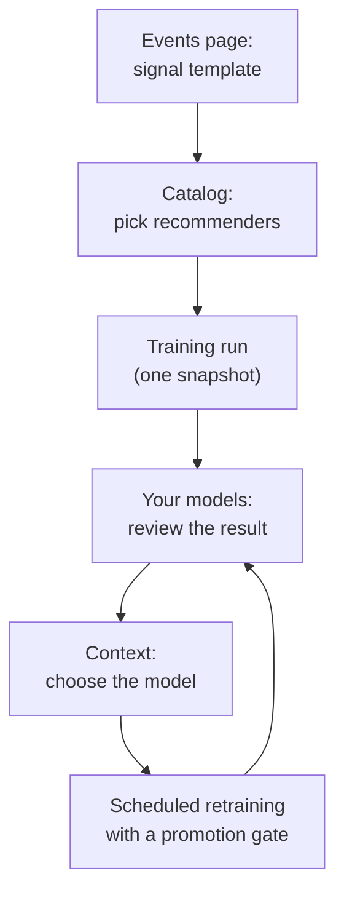

Every context is served by a model. Until you train one, contexts use **Automatic**: NSL's shared base models, which work from your item descriptions and general behaviour patterns. Training a model on your own events is how recommendations become specific to your users.

Open **Models → Models**. The page has two tabs: **Catalog** to choose what to train, and **Your models** to manage what you have trained.

## The flow

Retraining never overwrites a model in place. Each run produces a new version, which only replaces the serving version if you deploy it or it passes the promotion gate.

See [Recommendation architectures](/console/model-architectures) for what each catalogue model does and how to compare candidates.

## Catalog

The catalogue lists every recommender you can train, with how well it performs, what it costs and whether your data is ready for it.

| Column | Meaning |
| --- | --- |
| **Recommender** | The architecture, for example item-KNN, EASE, SASRec, BERT4Rec, LightGCN, iALS, a two-tower model with a ranking stage, or a generative model |
| **Quality** | Overall benchmark score, out of 100 |
| **Cost / mo** and **Latency** | Reference serving cost and response time |
| **Your data** | **Eligible**, or **Readiness checks required** if your events do not yet meet its needs |

Use the search box, **Filter by architecture family**, and **Rank by scenario** (for example cold start or long sessions) to narrow the list. Labels mark **New** and **Generative** recommenders; **Baseline** entries are benchmark references and cannot be selected.

Select a recommender to see:

- **Scenario performance**: how it ranks against the others in each situation a recommender has to handle.
- **Benchmark dimensions**: reference scores across public datasets under a shared protocol; check the dataset coverage and caveats for each entry.
- **Data it needs**: the signals and volume it requires.
- **Potential use cases**.
- **Training and serving**: training compute, serving mode, monthly serving cost, inference cost per 1,000 requests, model size and reference latency.

### Train

<Steps>
  <Step title="Select recommenders">
    Tick one or more recommenders. Each is trained as an independent job against one shared snapshot of your data, so their results are comparable.
  </Step>
  <Step title="Continue to training data">
    Choose the [signal template](/console/events#signal-templates) to train from, and check readiness and estimated cost.
  </Step>
  <Step title="Start training">
    Follow progress in [Model Training](/console/training). You are notified when runs finish.
  </Step>
</Steps>

Training your own models needs the Pro plan or above. Recommenders your plan cannot train show **Upgrade to train this model**.

## Your models

Each trained model shows whether it is **Live**, its version, deployment state (**Serving**, **Packaged, not deployed** or **No package yet**), the training data it used and whether it is up to date. **Platform base models** lists the shared models NSL publishes, which serve contexts set to **Automatic**.

Select a model to open its details:

| Section | Shows |
| --- | --- |
| **Overview** | Recommender, architecture, objective, dimensions, status, signal template and training job |
| **Customer evaluation** | How the model scored on your own held-out data |
| **Assigned contexts** | The contexts this model serves |
| **Package** and **Live endpoint** | Whether the model is packaged and serving |
| **History** | Training, promotion and deployment events |
| **Lifecycle** | Where the model is: trained, ready to promote, promoted, or failed |

Rename a model from its header to give it a label your team recognises. The system name, built from the template and run, is kept for traceability.

## Deploy a model

Open a compatible context in [Contexts](/console/contexts) and choose the packaged model under **Details → Model**. Select **Review & deploy**, inspect its customer evaluation, and confirm deployment to that context. The context uses its fallback until the endpoint is ready. The current trained recommender endpoint accepts a user ID and count, so trained catalogue recommenders can serve **Personalized discovery** and **Email digest** contexts. Other context types keep their purpose-built retrieval path.

To roll back, choose the previous model or **Automatic** in the same place.

## Scheduled retraining

Open a model and turn on **Retrain on a schedule** to keep it current automatically.

| Setting | Meaning |
| --- | --- |
| **Frequency** | Daily, weekly (choose the day) or monthly (choose the day of month) |
| **Minimum new events** | Skip a run when fewer events than this have arrived since the last snapshot, so you do not pay to retrain on unchanged data |
| **Promotion gate** | A finished run must **beat the live model by at least** this margin to replace it. A run that misses stays a draft and nothing changes |
| **Deploy automatically** | When a run passes the gate, move every context this model serves onto the new version. Turn it off to have winning runs wait for your review |

The panel shows the next and last run, and each run's outcome: **Promoted**, **Kept the current version** or **Skipped**. A model whose signal template has been deleted cannot be retrained.

## Model families

Each model belongs to a **family** that describes its job, such as general recommendations, similar items, trending or email digest. Choose the family and compatible retrieval architecture in the context's **Details** tab. A family contains:

- the **base models** NSL publishes, any of which can seed your own fine-tune;
- your **fine-tuned versions**, the newest ready one of which overrides the base for your workspace;
- the architectures available in the family.

When a context serves from a family, NSL uses your latest ready fine-tune, then the family's base model, then the general base model if nothing in the family is ready.
