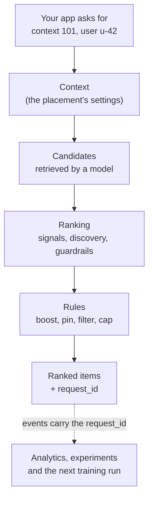

NeuronSearchLab (NSL) gives you personalised recommendations and search without building the retrieval, ranking and training stack yourself. Your application sends three things, and gets one thing back:

| You send | What it is | How |
| --- | --- | --- |
| **Items** | The things you could recommend: products, listings, articles, videos | [Catalogue](/integrate/catalogue) |
| **Events** | What people do with those items: views, clicks, purchases, searches | [Events](/integrate/events) |
| **Requests** | "What should this person see here?" | [Recommendations](/integrate/recommendations) and [Search](/integrate/search) |

NSL returns a ranked list of items for each request, and records which list a person saw so that later events can be credited to it.

## How a recommendation is made

For predictable placement behaviour, send a **context** with each request: one placement in your product, such as a homepage feed or a "similar items" rail. The context decides which model retrieves candidates, how they are ranked, and which business rules apply. Operators change a context in the console; your code keeps sending the same `context_id`. See [Key concepts](/concepts) for every term on this page.

## Choose how to start

<CardGroup cols={2}>
  <Card title="Quickstart (API)" icon="bolt" href="/quickstart">
    Create credentials, send an item and an event, and fetch recommendations in about ten minutes.
  </Card>
  <Card title="No-code start" icon="wand-magic-sparkles" href="/instant-start">
    Paste your website's address. NSL builds the catalogue from your pages.
  </Card>
  <Card title="Website embed" icon="code" href="/embed">
    One script tag renders recommendations and records views and clicks for you.
  </Card>
  <Card title="Shopify, Magento and other platforms" icon="store" href="/embed/shopify">
    Install the app or module for your shop platform.
  </Card>
</CardGroup>

| If you are... | Start with |
| --- | --- |
| A developer adding recommendations to your own app or API | [Quickstart](/quickstart), then the [SDK for your language](/sdk/overview) |
| Running a website and want results without backend work | [No-code start](/instant-start) and the [Website embed](/embed) |
| Running a Shopify, Magento, WooCommerce, BigCommerce, Shopware or PrestaShop store | [Shopify](/embed/shopify) or [other platforms](/embed/platforms) |
| Deploying a Next.js app on Vercel | [Vercel integration](/platforms/vercel) |
| An operator tuning what people see | [Console tour](/console/overview) and [Contexts](/console/contexts) |
| Working from an AI assistant | [ChatGPT and MCP](/sdk/mcp) |

## What is in these docs

<CardGroup cols={3}>
  <Card title="Integrate" icon="plug" href="/integrate/authentication">
    Credentials, catalogue, events, recommendations, search, history imports and identity.
  </Card>
  <Card title="Console" icon="browser" href="/console/overview">
    Every page of the console, in the order the sidebar shows them.
  </Card>
  <Card title="Playbooks" icon="route" href="/playbooks/launch-a-placement">
    Step-by-step tasks that combine several features.
  </Card>
  <Card title="SDKs" icon="cube" href="/sdk/overview">
    JavaScript, PHP, Next.js and Swift clients, and the MCP server.
  </Card>
  <Card title="API reference" icon="code" href="/api-reference/introduction">
    The Core API for your application and the Platform API for automation.
  </Card>
  <Card title="Changelog" icon="clock-rotate-left" href="/changelog">
    What changed, by product area.
  </Card>
</CardGroup>

<Note>
  For background on how recommendation systems work in general, read the [recommendation systems reading path](https://www.neuronsearchlab.com/blog/recommendation-systems).
</Note>
